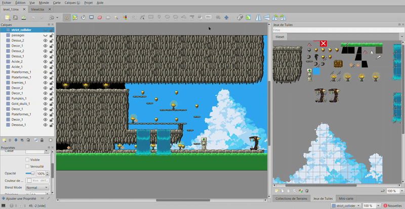

# Lost Cave

Jeu de plateforme 2D d'horreur réalisé en Python avec Pyxel, par Hadrien, Louka et Raphaël pour un projet en NSI.

## Lancer le jeu

Depuis la racine du projet :

```bash
pip install pyxel pygame
python main.py
```
Pygame est utilisé uniquement pour la lecture optimisée des audios haute qualité, sans impacter les performances du jeu. Si vous ne pouvez pas l'installer, vous pouvez passer à l'étape suivante
## Build Windows autonome

`build/Lost Cave.exe`, qui inclut Python et les ressources du jeu, permet de lancer directement le jeu en double-cliquant dessus.

Pour créer un nouvel exécutable, il faut entrer cette commande dans un terminal :

```powershell
python -m pip install pyinstaller
.\build.bat
```

L'exécutable peut être lancé depuis n'importe quel dossier et ne nécessite pas
d'installation de Python sur le PC de destination.

## Organisation

- `main.py` : lancement du jeu.
- `scripts/` : boucle fonctionnelle, états sous forme de dictionnaires,
  personnage, éclairage, entités et carte Tiled.
- `assets/sprites/` et `assets/audio/` : ressources du jeu.
- `assets/maps/` : cartes du niveau.

Le niveau utilise un éclairage radial qui suit le joueur, avec une penombre
ambiante et une transition douce autour de la zone éclairée. La lueur varie
doucement en continu ; son rayon de base, son amplitude, sa période, le fondu et
la luminosite ambiante se règlent dans `scripts/config.py`. Les cranes dorés et
les citrouilles récoltés sont comptés dans le HUD avec leurs icônes respectives.
La caméra tremble brievement lorsqu'un ennemi est écrasé ou que le joueur subit
des degats.

## Architecture pédagogique

Les scripts de `scripts/` n'utilisent pas de classes. `main.py` initialise
Pyxel, crée l'état du jeu avec `initialiser_jeu()`, puis délègue chaque image
aux fonctions `mettre_a_jour_jeu()` et `dessiner_jeu()`. Le joueur, la carte,
les entités et l'éclairage sont représentés par des dictionnaires manipulés
par des fonctions dédiées.

Nous avons utilisé l'outil Tiled pour créer le niveau et ses cartes, plutôt que l'éditeur de base de Pyxel. Les définitions des ennemis sont centralisées dans `scripts/entites_niveau.py`, où les réglages partagés sont factorisés.

Voici la carte du niveau dans Tiled, avec ses calques de décor, de collision et
d'objets récupérables :



Le fichier `assets/maps/level_1.json` est l'export JSON de la carte
`assets/maps/level_1.tmx`, généré par Tiled. Le jeu y lit les calques et les
identifiants de tuiles pour préparer les collisions : il ne faut donc pas le
modifier à la main. Après une modification de la carte dans Tiled, réexportez
le fichier au format JSON en conservant le nom `level_1.json`. Le fichier
`level_1_pyxel.json` est utilisé séparément pour dessiner la carte dans le jeu.

La carte convertie et les données de collision sont chargées une seule fois.
Les collisions sont précalculées en ensembles de coordonnées; il y a seulement les tiles
visibles qui sont dessinés. Les définitions Python des entités deviennent des
dictionnaires indépendants au démarrage, et leurs sprites sont chargés à ce moment.
